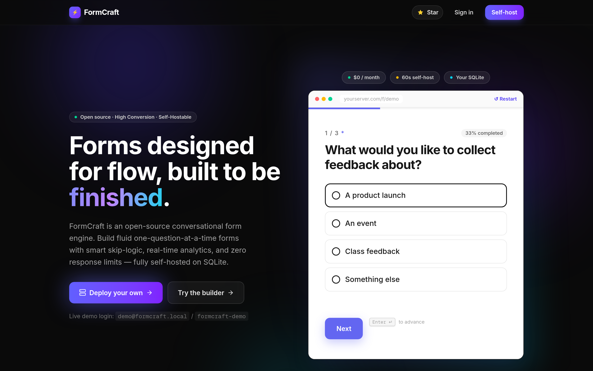
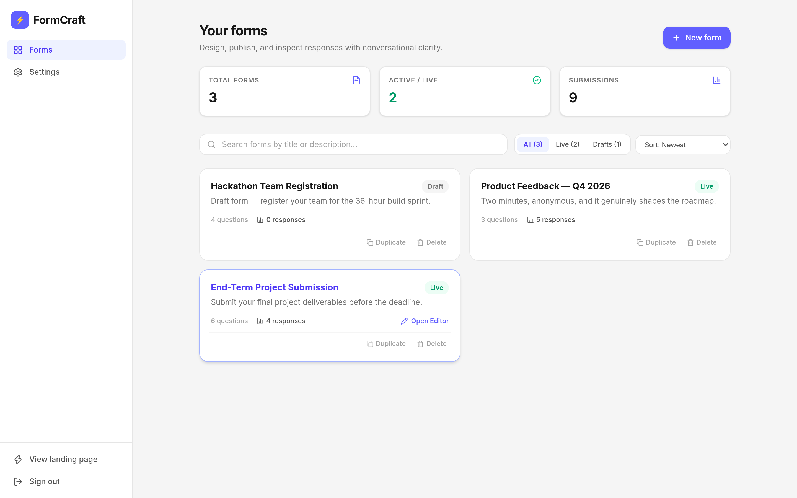
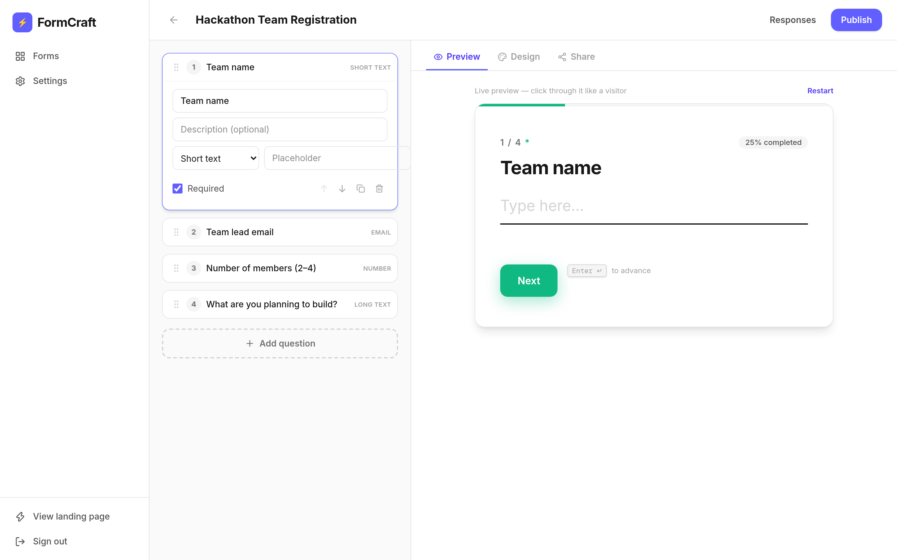
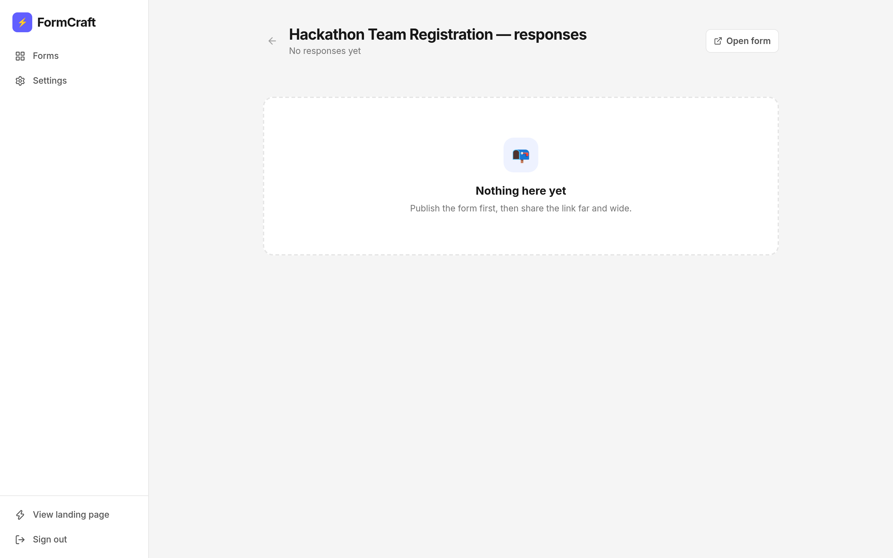
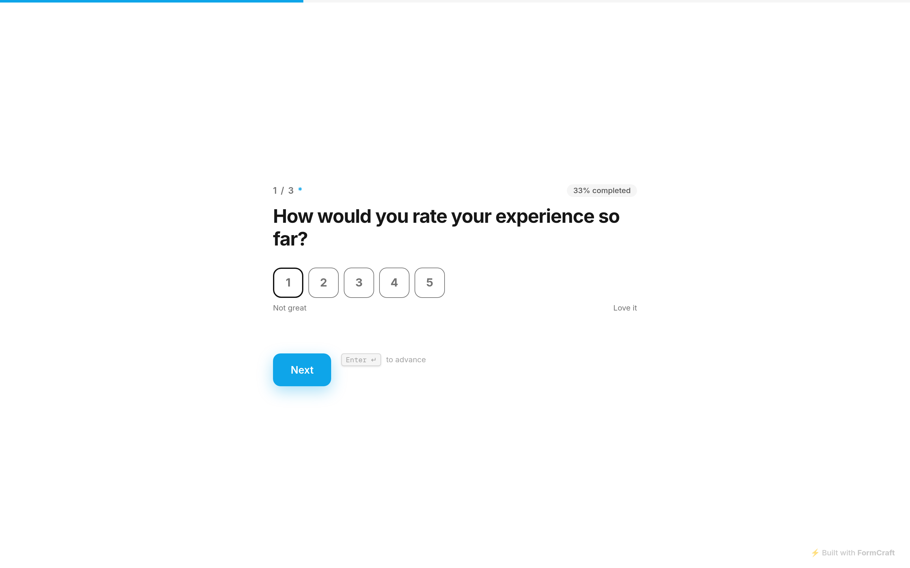
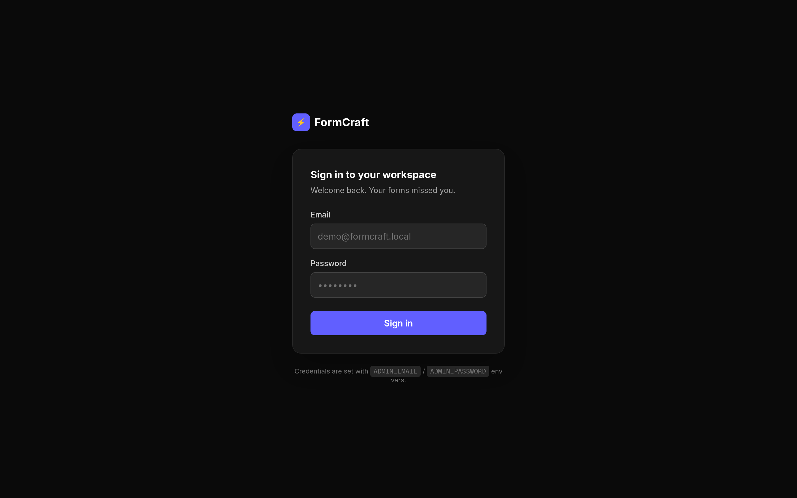

# ⚡ FormCraft — Conversational Form Engine

> **Forms designed for flow, built to be finished.**  
> An open-source, self-hostable conversational form builder and analytics engine. One-question-at-a-time flow, intelligent skip logic, real-time responses, and zero monthly SaaS bills.

[](./package.json)
[](https://nextjs.org/)
[](https://react.dev/)
[](https://www.typescriptlang.org/)
[](https://tailwindcss.com/)
[](https://orm.drizzle.team/)
[](./LICENSE)


                      ┌───────────────────────────────────────────────┐
                      │THIS PROJECT DOES NOT PROVIDE HOSTING OPTIONS  │
                      │   BUT , IS MADE SUCH A WAY TO SELF HOST       │
                      │     EASILY . DUMMY CREDS ARE GIVEN TO         │
                      │             TEST DIRECTLY                     │
                      └───────────────────────────────────────────────┘
creds: (will be taken down in future)
mail : purposeno968@gmail.com
pass : render

---

## 📸 Screenshots

| | |
|---|---|
|  |  |
| Landing page with an interactive live demo | Workspace dashboard — metrics, search, status filters, sorting |
|  |  |
| Split-screen builder with live preview | Per-question analytics + individual response drill-down |
|  |  |
| Conversational runner (one question at a time) | Admin sign-in (HMAC-signed session cookie) |

---
## video link


---

## 📌 Problem Statement

Traditional online forms (Google Forms, SurveyMonkey, standard web forms) suffer from dismal completion rates (often <15%) because respondents are presented with a giant wall of input fields. Conversely, premium conversational form tools like Typeform charge exorbitant fees ($35–$100+/month), impose strict monthly response caps, paywall basic conditional branching, and store sensitive respondent data on proprietary third-party cloud infrastructure.

Developers, researchers, event organizers, and student teams need a modern, beautiful, and fluid conversational form engine that:
1. Gives respondents a focused, keyboard-first, one-question-at-a-time experience.
2. Supports complex conditional skip/branching logic.
3. Provides live analytics and CSV exports without subscription paywalls.
4. Stores data in a transparent, self-hosted local database with zero external cloud dependencies.

---

## 🎯 Target Users

- **Developers & Product Builders**: Embed fast, unbranded forms, survey popups, or feedback widgets via a single `<script>` tag or iframe.
- **Educators & Students**: Collect project submissions, peer reviews, lab evaluations, and course feedback with structured templates.
- **Event Organizers & Community Leads**: Gather RSVPs, meal preferences, and attendee details with mobile-first conversational flows.
- **Privacy-Conscious Organizations**: Self-host entire form infrastructure and store all survey data in their own SQLite file without third-party data tracking.

---

## 💡 Solution: FormCraft

**FormCraft** solves this by providing a lightweight, full-stack Next.js 16 web application that enables anyone to build, publish, embed, and analyze interactive forms with zero runtime cost.

By leveraging an embedded SQLite database (`better-sqlite3` + `Drizzle ORM`), the entire backend runs in a single self-contained environment. You can deploy it on any server, container, or VPS in under 60 seconds with no external database subscriptions.

---

## 🚀 Key Features & Core Workflows

### 1. Visual Drag-and-Drop Form Builder
- **9 Specialized Question Types**: Short Text, Long Text, Email, Number, Multiple Choice, Checkboxes, Dropdown, Rating scale (1–10), and Yes/No boolean.
- **Live Interactive Split-Screen Preview**: Real-time rendering of changes as questions, descriptions, placeholders, and themes are edited.
- **Theme & Branding Customizer**: Custom brand colors, dark/light modes, progress bar toggling, and configurable Welcome & Thank You screens.
- **Pre-Configured Starter Templates**: Jumpstart form creation with templates for *Project Submission*, *Developer Bug Report*, *Event RSVP*, *Product Feedback*, and *Contact*.

### 2. Intelligent Conditional Skip Logic Engine
- Define custom branching rules per question (e.g., *"If answer is 'No', jump directly to Question 5"* or *"Submit immediately"*).
- State-machine driven navigation engine that recalculates the shortest path through the question graph while maintaining back-history traversal.

### 3. Fluid Conversational Form Runner
- **One-Question-at-a-Time Interface**: Distraction-free, responsive layout with smooth transitions and real-time completion percentage tracking.
- **Keyboard-First Navigation**: Advance with `Enter ↵`, step back with `Esc`, and navigate choices with keyboard numbers.
- **Built-in Security & Anti-Spam**:
  - Hidden honeypot traps for bot filtering.
  - Client-side and server-side submission time analysis (blocks instant automated bot submissions).
  - Rate limiting per IP.

### 4. Real-Time Responses & Analytical Insights
- **Live Response Feed**: Instant notification and rendering of new respondent answers.
- **Aggregated Question Metrics**: Distribution charts for multiple-choice questions, average scores for ratings, and text breakdowns.
- **One-Click CSV Export**: Instant structured data export for analysis in Excel, Python, or Pandas.

### 5. Multi-Channel Distribution & Integrations
- **Public Shareable Link**: Clean slug URLs (e.g. `/f/project-evaluation`).
- **QR Code Generator**: In-app QR code generation for scanning at events or conferences.
- **Embeddable Widgets**:
  - Inline `<iframe>` embed.
  - Floating popup corner button with a single lightweight `<script>` tag.
- **Webhook Dispatch**: Instant event notification payload sent to Slack, Discord, or custom webhook endpoints on submission.

---

## 🛠️ Tech Stack & Engineering Decisions

| Layer | Technology | Decision Rationale |
|---|---|---|
| **Framework** | Next.js 16.3 (App Router + Turbopack) | Server Actions, dynamic routes, and fast edge-ready compilation |
| **Frontend** | React 19, TypeScript 5, Tailwind CSS 4 | Type safety, zero-runtime styling, and responsive UI |
| **Database** | SQLite (`better-sqlite3`) | Single-file persistence, zero configuration, zero cloud cost, portable backups |
| **ORM** | Drizzle ORM | Schema-first type-safe queries with blazingly fast execution |
| **Icons & Media** | Lucide React | Modern, lightweight icon system |
| **Validation** | Zod | Runtime schema validation for question graphs, form settings, and submissions |
| **QR Generation** | `qrcode` | In-memory SVG/DataURL generation for offline QR code access |

---

## 🏗️ Architecture Overview

```text
┌─────────────────────────────────────────────────────────────────┐
│                           Client Layer                          │
├───────────────────────────────┬─────────────────────────────────┤
│    Admin Dashboard & Builder   │     Conversational Runner       │
│  - Live Form Editor           │  - Step-by-step state machine   │
│  - FormList & Search Filter   │  - Keyboard shortcuts handler   │
│  - Analytics & Charts         │  - Embed widget / Popup modal   │
└───────────────┬───────────────┴─────────────────┬───────────────┘
                │ HTTP / Server Actions           │ Public Submissions
                ▼                                 ▼
┌─────────────────────────────────────────────────────────────────┐
│                      Next.js 16 Server                          │
├─────────────────────────────────────────────────────────────────┤
│  - Route Handlers (/api/forms, /api/public/submit, /api/qr)     │
│  - Auth Middleware (HMAC SHA-256 signed session cookies)        │
│  - Honeypot & Anti-Bot validation pipeline                      │
│  - Conditional Branching Validator                              │
│  - Webhook Dispatcher (Slack / Discord / Custom HTTP)           │
└───────────────────────────────┬─────────────────────────────────┘
                                │ Drizzle ORM
                                ▼
┌─────────────────────────────────────────────────────────────────┐
│                      SQLite Engine (WAL Mode)                   │
├─────────────────────────────────────────────────────────────────┤
│  - `forms` Table: Slugs, titles, question JSON graph, settings  │
│  - `responses` Table: Form ID, JSON answers, submission dates   │
│  - `app_settings` Table: Global workspace & AI configurations   │
└─────────────────────────────────────────────────────────────────┘
```

---

## ⚙️ Environment Variables

Copy `.env.example` to `.env` or set these in your hosting environment:

| Variable | Default | Purpose |
|---|---|---|
| `ADMIN_EMAIL` | `admin@formcraft.local` | Email address used to access the admin dashboard |
| `ADMIN_PASSWORD` | `formcraft-admin` | Password used to log in to the dashboard |
| `AUTH_SECRET` | *(auto-dev)* | HMAC secret key used for signing session cookies |
| `DATA_DIR` | `./data` | Directory where `formcraft.db` SQLite database is saved |
| `OPENAI_API_KEY` | *(optional)* | OpenAI or Groq/Ollama API key for AI form generation |
| `OPENAI_BASE_URL`| `https://api.openai.com/v1` | Custom endpoint for OpenAI-compatible LLM providers |
| `AI_MODEL` | `gpt-4o-mini` | AI model name for drafting form questions |
| `SEED_DEMO` | `false` | When `true`, seeds 3 demo forms + 9 sample responses on an empty database |

> **Note**: No secrets or API keys are required for core form creation, running, submission, or export.

---

## 💻 Local Setup & Quickstart

### Prerequisites
- Node.js 20 or higher
- npm, pnpm, or bun

### 1. Clone & Install
```bash
git clone https://github.com/vaibhav25bcs10507-pixel/formcraft.git
cd formcraft
npm install
```

### 2. Run Development Server
```bash
npm run dev
```
Open **[http://localhost:3000](http://localhost:3000)** in your browser.

- Visit `/login` to sign in to the Admin Dashboard.
- **Local defaults** (when no env vars are set): `admin@formcraft.local` / `formcraft-admin`
- **Live demo** (https://formcraft-4sqx.onrender.com): `demo@formcraft.local` / `formcraft-demo`

> Change `ADMIN_EMAIL` / `ADMIN_PASSWORD` before using this for anything beyond a demo.

### 3. Production Build & Run
```bash
npm run build
npm start
```

### 4. Running with Docker Compose (Alternative)
```bash
docker compose up -d
```

### 5. Running the End-to-End Test Suite
The repo ships a Playwright suite (`scripts/e2e.mjs`) that drives a real browser
against a running instance — landing demo, login, template creation, autosave,
publishing, public submission, response analytics, CSV export, QR code, embed
script, draft blocking, skip-logic branching, duplication and deletion.

```bash
npm run build && npm start            # in one terminal
BASE_URL=http://localhost:3000 npm run test:e2e   # in another
```

23 checks are executed. If the bundled Playwright browser is not downloaded, point
the suite at a system Chrome instead:

```bash
CHROME_PATH=/usr/bin/chromium BASE_URL=http://localhost:3000 npm run test:e2e
```

> The suite writes screenshots to `/tmp/formcraft-shots`.

---

## 🚢 Deployment

FormCraft is designed to run in any containerized or Node.js environment:

### Deploy to Render

**Live instance:** https://formcraft-4sqx.onrender.com (free tier — the first request after 15 minutes of inactivity may take ~30–60s to wake).

1. Create a **Web Service** on [Render](https://render.com).
2. Connect your GitHub repository.
3. Choose **Node** environment:
   - **Build Command**: `npm ci && npm run build`
   - **Start Command**: `npm start`
4. Set `ADMIN_EMAIL`, `ADMIN_PASSWORD`, `AUTH_SECRET`, `COOKIE_SECURE=true`, and `DATA_DIR=./data` in Environment Settings.
5. Optional: attach a Persistent Disk at `/data` and set `DATA_DIR=/data` if you want SQLite data to survive redeploys. The demo deployment intentionally runs without a disk, so data resets on redeploy.

### Deploy to Railway / Fly.io / VPS
Use the included `Dockerfile` and `docker-compose.yml` for automated container deployment.

